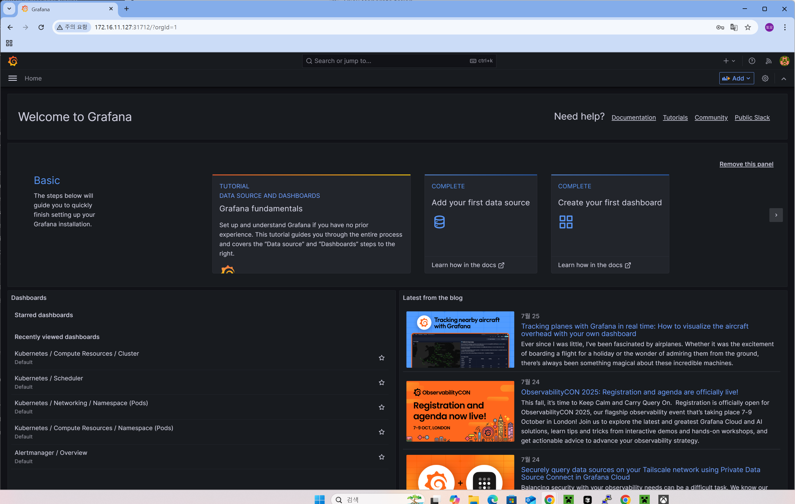
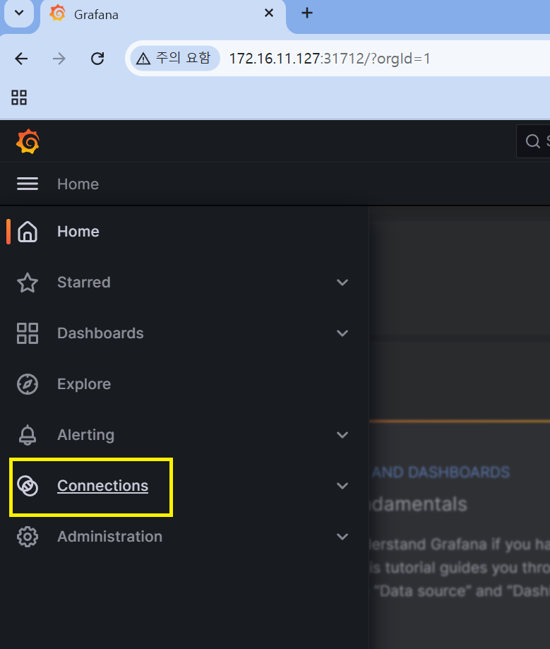
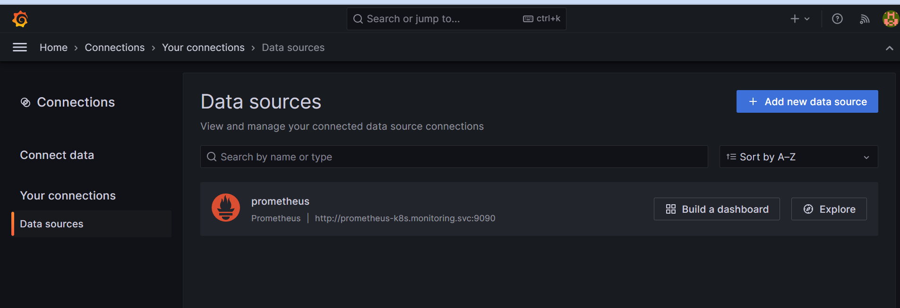
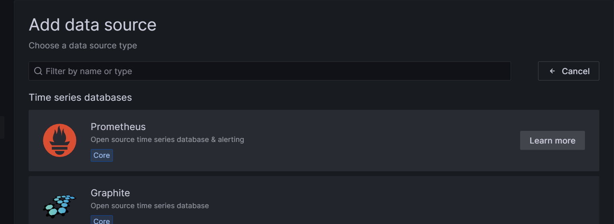
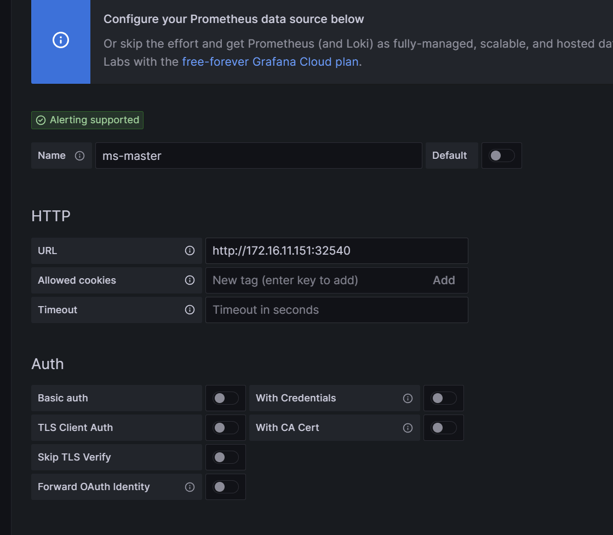
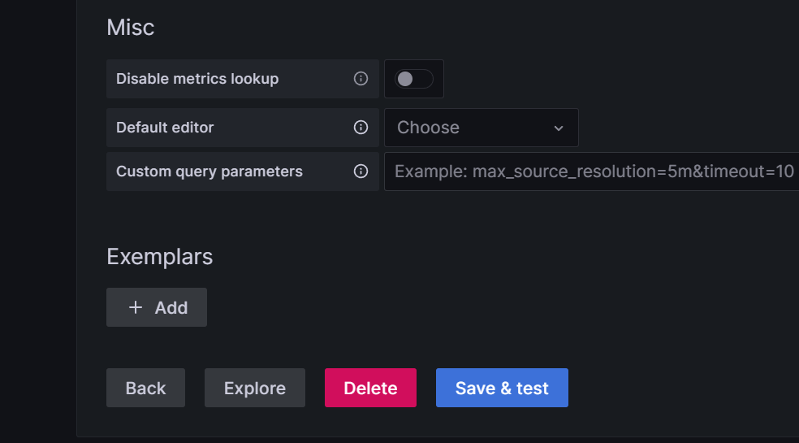
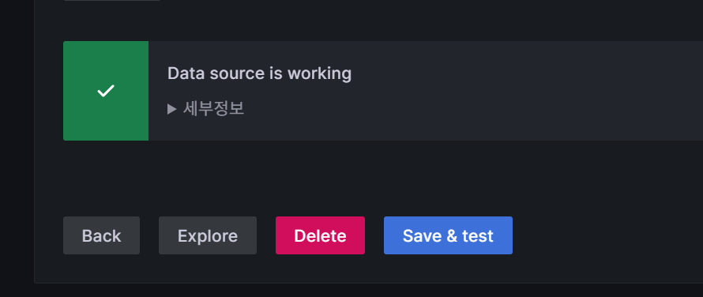
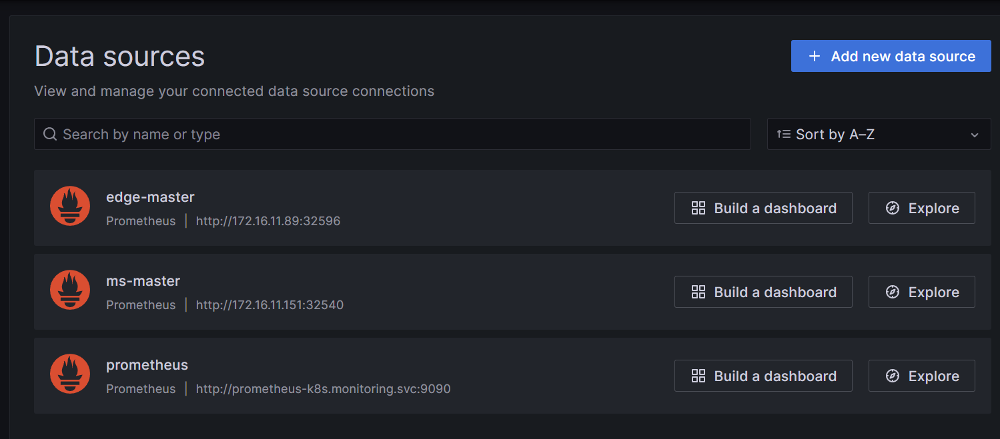

# kubernetes monitoring

kubernetes monitoring을 하기 위해서는 아래의 사이트를 참고하여 설치한다.

https://github.com/prometheus-operator/kube-prometheus

## 설치

kubernetes 1.28에서 작업하기 때문에 releae 0.13을 이용해야 한다.

```sh
git clone -b release-0.13 https://github.com/prometheus-operator/kube-prometheus.git
```

```sh
kubectl apply --server-side -f manifests/setup
kubectl wait \
	--for condition=Established \
	--all CustomResourceDefinition \
	--namespace=monitoring
kubectl apply -f manifests/
```

## remove network policy

외부에서 접근해야하기 때문에, grafana 및 prometheus network policy를 삭제하자.

```sh
kubectl delete -f manifests/grafana-networkPolicy.yaml 
kubectl delete -f manifests/prometheus-networkPolicy.yaml
```


## 서비스 NodePort 또는 LoadBalancer로 변경

Grafa 서비스 및 Prometheus 서비스를 외부에서 접근 가능하게 LoadBalancer로 변경하겠다.
이 시스템은 로드밸랜서를 위한 metallb가 이미 설치가 되어 있다.

### Grafa 서비스

manifests/grafana-service.yaml

```yaml
apiVersion: v1
kind: Service
metadata:
  labels:
    app.kubernetes.io/component: grafana
    app.kubernetes.io/name: grafana
    app.kubernetes.io/part-of: kube-prometheus
    app.kubernetes.io/version: 9.5.3
  name: grafana
  namespace: monitoring
spec:
  ports:
  - name: http
    port: 3000
    targetPort: http
  selector:
    app.kubernetes.io/component: grafana
    app.kubernetes.io/name: grafana
    app.kubernetes.io/part-of: kube-prometheus
  type: LoadBalancer

```

### Prometheus 서비스

manifests/prometheus-service.yaml

```yaml
apiVersion: v1
kind: Service
metadata:
  labels:
    app.kubernetes.io/component: prometheus
    app.kubernetes.io/instance: k8s
    app.kubernetes.io/name: prometheus
    app.kubernetes.io/part-of: kube-prometheus
    app.kubernetes.io/version: 2.46.0
  name: prometheus-k8s
  namespace: monitoring
spec:
  ports:
  - name: web
    port: 9090
    targetPort: web
  - name: reloader-web
    port: 8080
    targetPort: reloader-web
  selector:
    app.kubernetes.io/component: prometheus
    app.kubernetes.io/instance: k8s
    app.kubernetes.io/name: prometheus
    app.kubernetes.io/part-of: kube-prometheus
  sessionAffinity: ClientIP
  type: LoadBalancer
```


### 서비스 적용
```sh
kubectl apply -f manifests/grafana-service.yaml 
kubectl apply -f manifests/prometheus-service.yaml


kubectl get svc -n monitoring
NAME                    TYPE           CLUSTER-IP       EXTERNAL-IP     PORT(S)                         AGE
alertmanager-main       ClusterIP      10.97.9.14       <none>          9093/TCP,8080/TCP               25m
alertmanager-operated   ClusterIP      None             <none>          9093/TCP,9094/TCP,9094/UDP      24m
blackbox-exporter       ClusterIP      10.96.124.234    <none>          9115/TCP,19115/TCP              25m
grafana                 LoadBalancer   10.104.153.173   172.16.11.231   3000:31712/TCP                  117s
kube-state-metrics      ClusterIP      None             <none>          8443/TCP,9443/TCP               25m
node-exporter           ClusterIP      None             <none>          9100/TCP                        25m
prometheus-adapter      ClusterIP      10.109.132.207   <none>          443/TCP                         25m
prometheus-k8s          LoadBalancer   10.110.147.229   172.16.11.230   9090:31122/TCP,8080:30978/TCP   2m15s
prometheus-operated     ClusterIP      None             <none>          9090/TCP                        24m
prometheus-operator     ClusterIP      None             <none>          8443/TCP                        25m

```

### 접속

맨 처음 접속시 id 및 패스워드는 admin/admin 이다.




## Grafana 접속 및 embeded allow

토큰 없이 Grafana정보를 보기 위해서는 grafana-config.yaml을 수정하여야 한다.

manifests/grafana-config.yaml

```yaml
apiVersion: v1
kind: Secret
metadata:
  labels:
    app.kubernetes.io/component: grafana
    app.kubernetes.io/name: grafana
    app.kubernetes.io/part-of: kube-prometheus
    app.kubernetes.io/version: 9.5.3
  name: grafana-config
  namespace: monitoring
stringData:
  grafana.ini: |
    [date_formats]
    default_timezone = Asia/Seoul
    [feature_toggles]
    enable = displayAnonymousStats
    [auth.anonymous]
    enabled = true
    [security]
    allow_embedding = true
    cookie_samesite = lax
    cookie_secure = false
    force_https = false
    [live]
    allowed_origins = *
type: Opaque


```

```sh
kubectl apply -f manifests/grafana-config.yaml 
kubectl delete -f manifests/grafana-deployment.yaml 
kubectl apply -f manifests/grafana-deployment.yaml
```

## 서브 클러스터 설치

서브 클러스터에서 설치시는 Grafana가 필요 없기 때문에, 아래 명령어를 실행한다.
또한 prometheus의 networkpolicy가 필요 없기 때문에 삭제 하자.

### 필요없는 설정 파일 삭제제
```sh
rm manifests/grafana-*
rm manifests/prometheus-networkPolicy.yaml
```

### prometheus 서비스 변경 (NodePort)

manifests/prometheus-service.yaml

```yaml
apiVersion: v1
kind: Secret
metadata:
  labels:
    app.kubernetes.io/component: grafana
    app.kubernetes.io/name: grafana
    app.kubernetes.io/part-of: kube-prometheus
    app.kubernetes.io/version: 9.5.3
  name: grafana-config
  namespace: monitoring
stringData:
  grafana.ini: |
    [date_formats]
    default_timezone = Asia/Seoul
    [feature_toggles]
    enable = displayAnonymousStats
    [auth.anonymous]
    enabled = true
    [security]
    allow_embedding = true
    cookie_samesite = lax
    cookie_secure = false
    force_https = false
    [live]
    allowed_origins = *
type: Opaque


```


### 설치

```sh
kubectl apply --server-side -f manifests/setup
kubectl wait \
	--for condition=Established \
	--all CustomResourceDefinition \
	--namespace=monitoring
kubectl apply -f manifests/
```


## Prometheus 접속 주소 확인 (prometheus-k8s)

여기서는 다른 2개의 클러스터가 있다.
- ms-master : 172.16.11.151:32540 
- edge-master : 172.16.11.89:32596


## Grafana 연결


### connection
그라파나에 접속하여 connection을 클릭한다.




### Data Souces
Data Souces를 클릭하고 오른쪽 상단의 Add new data source를 클릭하자.




### Add Data Source

Prometheus를 클릭한다.




### Name 및 URL 입력

Name 및 URL 입력




### Save & Test

Save & Test 버튼을 클릭한다.




아래는 성공한 화면인다.




### 추가된 클러스터


